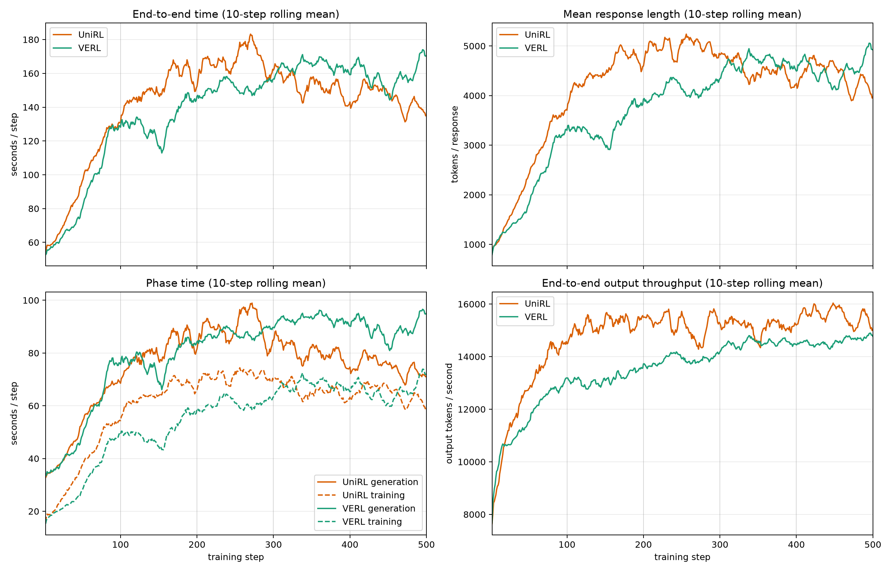

# Qwen3-4B GRPO: UniRL and veRL performance

This bundle reproduces a matched 500-step Qwen3-4B **standard GRPO** workload in
UniRL and veRL. It replaces the earlier DRPO bundle as the E3-AR evidence, so the
systems comparison runs the algorithm that `EXPERIMENT_RUNBOOK.md` §6.2
registers (see issue #9). The primary experiment uses naturally varying response
lengths, EOS enabled, and an 8,192-token response cap.

## Recipe

| Setting | Value |
|---|---|
| Hardware | 2 nodes × 8 NVIDIA H20 96GB per framework |
| Model | Qwen3-4B-Base |
| Data | DAPO-Math-17k, 17,917 prompts |
| Algorithm | Standard GRPO (DeepSeekMath) |
| Advantage | `(reward − group_mean) / group_std`, group scope |
| Clip | symmetric PPO clip ε = 0.2 |
| Loss aggregation | `seq-mean-token-mean` (per-sequence token mean) |
| Rollout batch | 64 prompts × 8 samples = 512 responses |
| Sampling | temperature 1.0, top-p 1.0, top-k disabled, EOS enabled |
| Response cap | 8,192 tokens |
| Optimizer work | Four updates per rollout, 10,240-token budget per GPU |
| Measured window | Steps 2–500; step 1 excluded as startup warm-up |

- [UniRL recipe](unirl_natural_recipe.yaml): eight SGLang TP2 engines, HTTP
  backend, concurrency 64, Triton prefill, and FlashInfer decode.
- [veRL recipe](verl_natural_recipe.yaml): eight asynchronous vLLM TP2 engines.

Both runs start from the same base weights and match prompt order, tokenizer,
optimizer, precision, rollout batch, and update count. The three GRPO
normalization choices (advantage ÷ group std, per-sequence token-mean loss,
symmetric clip) are set identically on both sides.

## Recipe and effective-work audit

[`recipe_parity_audit.json`](recipe_parity_audit.json) compares the two
**resolved** job configurations field by field and checks fifteen
cross-framework effective-work identities (responses per rollout, updates per
rollout, token budget per GPU, learning rate, clip bounds, sampling parameters,
GPU count). All fifteen hold and every pinned field resolves as intended.

The audit also records two semantic divergences that configuration cannot
remove, because the two codebases compute the same named quantity differently:

1. **Group standard deviation.** UniRL uses the population standard deviation
   (`torch.std(unbiased=False)`); veRL uses the sample standard deviation
   (`torch.std` default). At n = 8 samples per prompt this makes veRL's
   advantages uniformly `sqrt(7/8) = 0.9354×` smaller — a fixed rescaling that
   acts like an effective learning-rate difference and does not change the sign
   or ranking of any advantage. Both sides were verified against the closed
   form: UniRL `rollout/advantage_max` = 2.645751 (predicted 2.645751), veRL
   `critic/advantages/max` = 2.474867 (predicted 2.474867).
2. **Advantage epsilon.** UniRL adds 1e-8 to the denominator, veRL 1e-6. With
   binary rewards at n = 8 the smallest non-zero group std is 0.3307, so the
   two epsilons differ by a relative 3e-6 — far below the factor above.

Two further differences are neutralized by configuration and verified empirically:
veRL's dual-clip lower bound (which UniRL does not implement) is pushed out of
reach with `clip_ratio_c = 10000.0`, and `actor/pg_clipfrac_lower` stayed 0.0 for
the whole run; degenerate-group handling is equivalent because every prompt is
sampled eight times.

### Recipe items outside the fifteen identities

`EXPERIMENT_RUNBOOK.md` §6.2 asks for more than the fifteen identities check.
The remaining items, and where each stands:

| Item | UniRL | veRL | Status |
|---|---|---|---|
| π_old anchor | GRPO default `old_logp_source: rollout` (not overridden) | `rollout_correction.bypass_mode: true`, `calculate_log_probs: true` | Matched: both use rollout-engine log-probs, no recompute pass |
| Prompt order | `torch.Generator` seeded 42 over `train.jsonl` | `RandomSampler` seeded 42 over `train-verl.parquet` | Same seeded shuffle over the same 17,917 rows; per-step prompt IDs not compared |
| Chat template | `enable_thinking: true` | tokenizer default (Qwen3 template defaults to thinking enabled) | Expected equal; prompt tokens not compared |
| Precision | fp32 master, bf16 FSDP params/autocast, fp32 log-probs | fp32 `model_dtype`, bf16 mixed precision | Same class (fp32 master, bf16 compute) |
| Training attention | `flex_attention` | veRL default FSDP path, `use_remove_padding: true` | Not matched |
| Reward placement | separate `RewardService` stage, math-verify on CPU (2.27 s/step) | DAPO reward manager inside async rollout (timer ≈ 0) | Not matched; part of each end-to-end system |
| Weight sync | separate timer (3.08 s/step) | not logged separately; inside the E2E remainder (≈ 3.5 s/step) | Phase timers not comparable |
| Realized response tokens | 4,197.6 mean, truncation 0.307 | 3,781.8 mean, truncation 0.203 | Not matched; follows each policy's trajectory |

## Curve and raw data

[`natural_long_per_step.csv`](natural_long_per_step.csv) contains 499 measured
steps for each framework. The plotted values use a 10-step rolling mean.



Regenerate the PNG with:

```bash
python3 artifacts/reported_results/2026-10-11-qwen3-4b-grpo/plot_long_natural.py \
  artifacts/reported_results/2026-10-11-qwen3-4b-grpo/natural_long_per_step.csv \
  artifacts/reported_results/2026-10-11-qwen3-4b-grpo/natural_long_curves.png
```

Additional tables:

- [phase timing by 100-step band](natural_long_by_phase.csv)
- [framework comparison by band and overall](natural_long_comparison.csv)

## Final performance

Mean ± population standard deviation over steps 2–500. Token rates divide total
generated tokens by total measured time.

| Framework | E2E s/step | Generation s/step | Training s/step | Mean response | E2E output tok/s | Generation output tok/s |
|---|---:|---:|---:|---:|---:|---:|
| **UniRL** | 143.519 ± 28.601 | **76.059 ± 15.129** | 61.196 ± 13.458 | 4,197.6 ± 1,005.4 | **14,975** | **28,257** |
| veRL | **139.894 ± 30.731** | 80.619 ± 16.308 | **55.743 ± 14.577** | 3,781.8 ± 1,039.1 | 13,841 | 24,018 |

Across the complete run, UniRL's raw end-to-end step time is 2.6% **higher**
than veRL's while it samples responses that are 11.0% longer. Its end-to-end
output-token throughput is 8.2% higher and generation output-token throughput is
17.7% higher.

| Framework | E2E median / p90 (s) | Generation median / p90 (s) | Training median / p90 (s) |
|---|---:|---:|---:|
| UniRL | 147.710 / 172.628 | 76.833 / 93.380 | 64.829 / 74.090 |
| veRL | 150.050 / 169.634 | 86.107 / 95.464 | 60.399 / 70.393 |

| Step band | veRL s/step (resp.) | UniRL s/step (resp.) | UniRL raw E2E | UniRL E2E tok/s | UniRL generation tok/s |
|---|---:|---:|---:|---:|---:|
| 0–100 | 90.70 (2,130) | 98.82 (2,533) | 8.9% slower | 9.2% higher | 20.4% higher |
| 100–200 | 132.51 (3,418) | 153.19 (4,557) | 15.6% slower | 15.3% higher | 27.7% higher |
| 200–300 | 152.00 (4,133) | 168.11 (4,979) | 10.6% slower | 8.9% higher | 17.3% higher |
| 300–400 | 164.38 (4,668) | 152.22 (4,501) | 7.4% faster | 4.1% higher | 11.9% higher |
| 400–500 | 159.39 (4,544) | 144.81 (4,401) | 9.1% faster | 6.6% higher | 16.4% higher |

The raw end-to-end ordering reverses around step 300 as the two response-length
distributions cross; token-normalized end-to-end throughput is higher for UniRL
in all five bands.

## Interpretation limits

- **The two frameworks ran on different nodes.** UniRL used
  `node-07e2836f5b849f5761976819` + `node-0862971ee23e3c6dbdabf8b3`; veRL used
  `node-22fc6dcf10baf73a823d2cc6` + `node-36d800314df2a77fbef5e357`. All four are
  8× H20 nodes in the same cluster, but the two runs executed concurrently on
  different physical machines. Node identity affects the time denominator of
  every reported rate, so it applies equally to raw step time and to the
  token-normalized rates; token normalization corrects for the response-length
  difference, not for hardware. `EXPERIMENT_RUNBOOK.md` §6.3 asks for systems to
  run one at a time on the same reserved hosts. The earlier DRPO bundle did not
  meet that either: UniRL's two nodes came from one allocation and veRL's from
  two separate allocations.
- **Response lengths diverged more than in the DRPO run** (11.0% here versus
  6.3% there), so the raw step-time ordering reflects how much text each side
  generated, not only how fast it generated it.
- This experiment contains one process-level run per system and does not
  establish repeated-run uncertainty or time-to-quality.

## Provenance

- UniRL W&B run:
  [`2x4tdjwa`](https://wandb.ai/leviking98z-zhejiang-university/unirl-grpo/runs/2x4tdjwa)
  (`grpo-unirl-natural500`)
- veRL run `grpo-verl-natural500`: 500/500 steps, 19 h 24 min wall clock; the
  per-step records come from the trainer's own console metrics.
- UniRL source commit: `6148a5d492bbe7dad32ca761a2de6d16a72bf067`, the same
  commit the DRPO bundle measured
- veRL reference source: `MaxwellJryao/SPO-DPPO@43803a66`; benchmark
  compatibility commit: `b170d4a6`
- UniRL config: `examples/ar/qwen3_grpo_4b_base_dapo_sglang.yaml`
- veRL algorithm settings: `adv_estimator=grpo`,
  `norm_adv_by_std_in_grpo=true`, `policy_loss.loss_mode=vanilla`,
  `clip_ratio=0.2`, `loss_agg_mode=seq-mean-token-mean`

UniRL phase timings and response lengths come from W&B; the two metric families
are logged on different W&B step indices and are joined on the `rollout/step`
counter. veRL prints every metric per step to its driver log; that log is not
committed to this bundle, so veRL-side diagnostics quoted above
(`actor/pg_clipfrac_lower`, `critic/advantages/max`) cannot be rechecked from
the bundle alone.

The committed UniRL recipe was resolved with `run_name: resolve-only`; the
measured run is `grpo-unirl-natural500` (`2x4tdjwa`). Cluster-local paths in the
recipes and audit are replaced with `<REPRO_ROOT>` (shared sync directory) and
`<CACHE_ROOT>` (node-local model and data cache).
